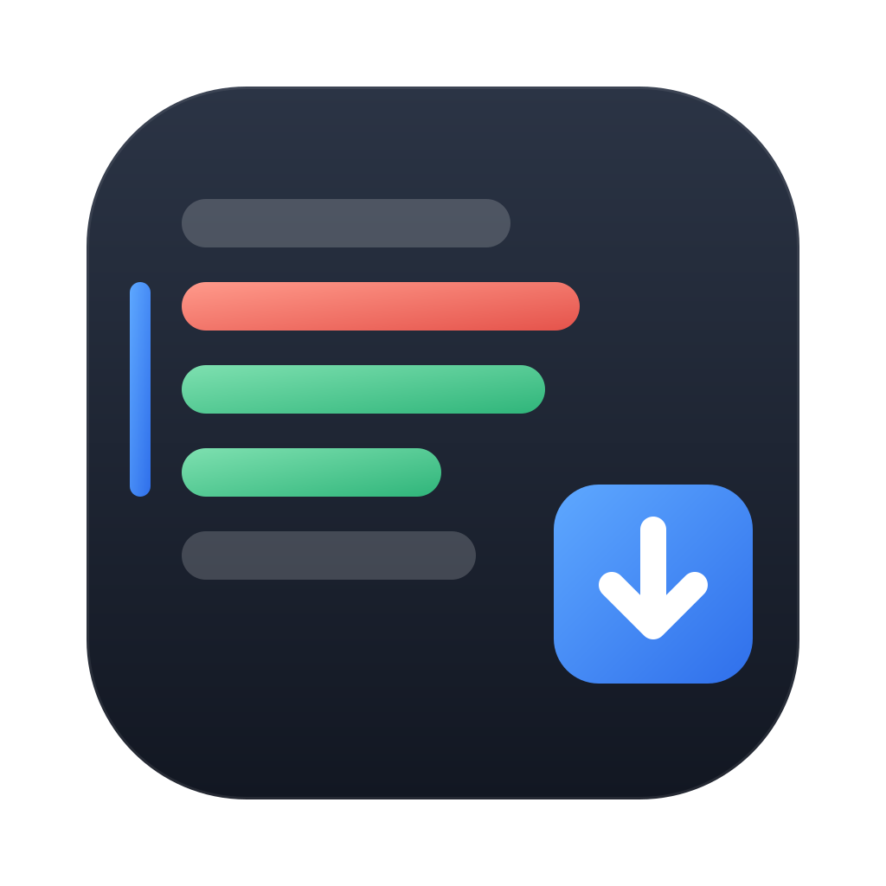
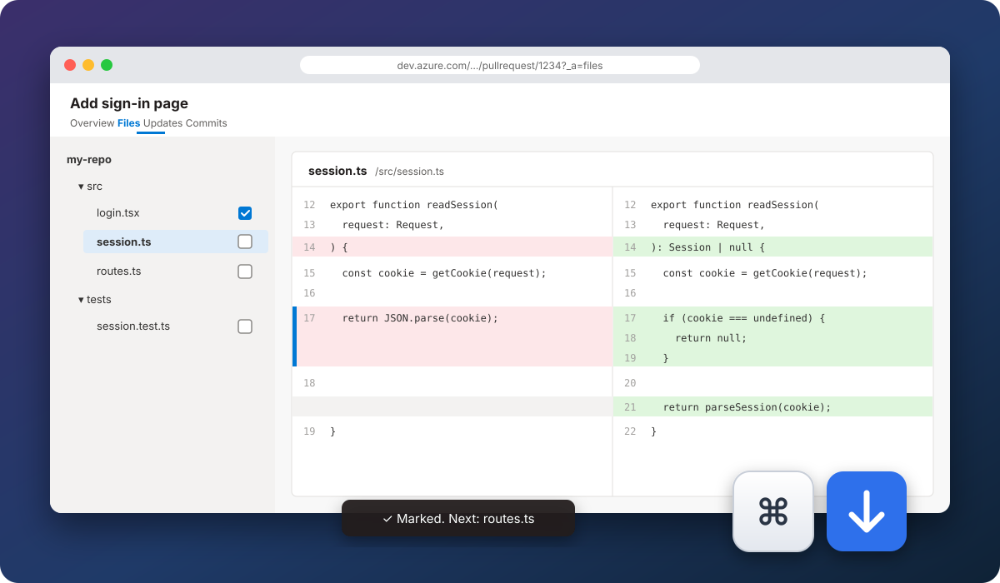

<p align="center">
  
</p>

<h1 align="center">Azure PR Review Keys</h1>

<p align="center">
  Review Azure DevOps pull requests without leaving the keyboard.<br>
  <kbd>⌘</kbd><kbd>↓</kbd> for the next change, <kbd>⌘</kbd><kbd>Enter</kbd> for the next file. That's it.
</p>

<p align="center">
  
  
  
  
  <a href="LICENSE"></a>
</p>

<p align="center">
  
</p>

Azure PR Review Keys is a Chrome extension for anyone who spends their day reviewing pull requests in Azure DevOps. Instead of hunting with the mouse for the next change and for each file's review checkbox, you jump from block to block with the arrow keys and close each file with <kbd>⌘</kbd><kbd>Enter</kbd>, which takes you straight to the next one left to review. It is a single script: no permissions, no dependencies, no network requests.

## Features

- **Next and previous change.** Jumps between changed blocks; at the end of a file, moves on to the next one.
- **Mark and move on.** <kbd>⌘</kbd><kbd>Enter</kbd> marks the file as reviewed and opens the next file you haven't reviewed yet, skipping the ones already marked.
- **Unmark.** On a file that is already reviewed, the same shortcut removes the mark.
- **Both modes of the Files tab:** one file at a time, or all files in a single scroll.
- **Stays out of the way.** While you type a comment the shortcuts are off, so <kbd>⌘</kbd><kbd>Enter</kbd> still posts the comment.
- **Shows what it did:** the current block gets a blue bar on its left, and a small toast confirms each file you mark.

## Shortcuts

| macOS | Windows / Linux | What it does |
| --- | --- | --- |
| <kbd>⌘</kbd><kbd>↓</kbd> | <kbd>Ctrl</kbd><kbd>↓</kbd> | Next change; at the end of the file, moves to the next file |
| <kbd>⌘</kbd><kbd>↑</kbd> | <kbd>Ctrl</kbd><kbd>↑</kbd> | Previous change |
| <kbd>⌘</kbd><kbd>Enter</kbd> | <kbd>Ctrl</kbd><kbd>Enter</kbd> | Marks the file as reviewed and opens the next unreviewed file (or unmarks it, if it was already reviewed) |

They work on the **Files** tab of any pull request on `dev.azure.com` and `*.visualstudio.com`.

> **Windows and Linux:** the extension works the same way, with <kbd>Ctrl</kbd> instead of <kbd>⌘</kbd>. It detects the operating system on its own; there is nothing to configure.

The on-screen messages are in Portuguese.

## Install

The extension is not on the Chrome Web Store; you install it from the source.

```bash
git clone https://github.com/gustavos00/azure-pr-review-keys.git
```

1. Open `chrome://extensions`.
2. Turn on **Developer mode**, in the top-right corner.
3. Click **Load unpacked** and pick the `azure-pr-review-keys` folder.
4. Reload the pull request page.

To update, run `git pull` in the folder and click the extension's ↻ button in `chrome://extensions`.

The steps are the same on macOS, Windows and Linux. Without git, download the repository as a ZIP (**Code › Download ZIP**) and extract it.

It also works in Edge, Brave, Arc and other Chromium-based browsers. In Edge, the page is `edge://extensions` and **Developer mode** is in the left-hand menu.

## Usage

1. Open a pull request and go to the **Files** tab.
2. Click the first file in the tree on the left.
3. Press <kbd>⌘</kbd><kbd>↓</kbd> until you reach the end of the file's changes.
4. Press <kbd>⌘</kbd><kbd>Enter</kbd>: the file is marked as reviewed and the next unreviewed file opens.
5. Repeat until the toast says there are no more files to review.

> It also works with the root or a folder selected (all files in a single scroll), but there <kbd>⌘</kbd><kbd>Enter</kbd> can only mark a file whose name is visible in the tree. With one file at a time this never happens.

## How it works

| Part | How |
| --- | --- |
| One file open | Uses Azure's own *Previous / Next difference* buttons, which already cross file boundaries |
| All files | Finds the changed blocks in the diff cards; when it runs out of loaded content, scrolls down so Azure loads more |
| Mark as reviewed | Clicks the *Mark as reviewed* checkbox on the file's row in the tree |
| Next unreviewed file | Walks the tree from the current file, scrolling as it goes because Azure only renders the visible rows |
| Keyboard | A capturing `keydown` listener on the window that ignores text fields |

All of this depends on the structure of the Azure DevOps page. If Microsoft changes it, the shortcuts may stop working until they are adjusted.

## Privacy

The extension asks for no permissions, stores nothing and makes no network requests. `content.js` only runs on Azure DevOps pages and only reacts to the three shortcuts above.

## Structure

```
manifest.json   extension manifest (Manifest V3)
content.js      shortcuts and navigation
docs/           icon and README image
```

## License

[MIT](LICENSE) © Gustavo Santos
